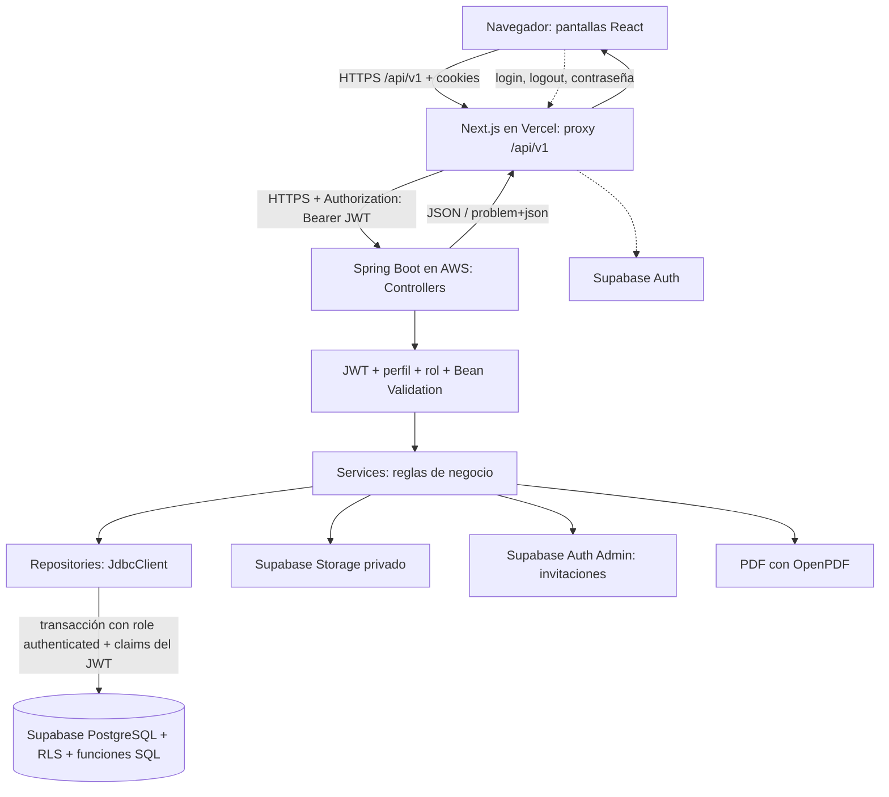
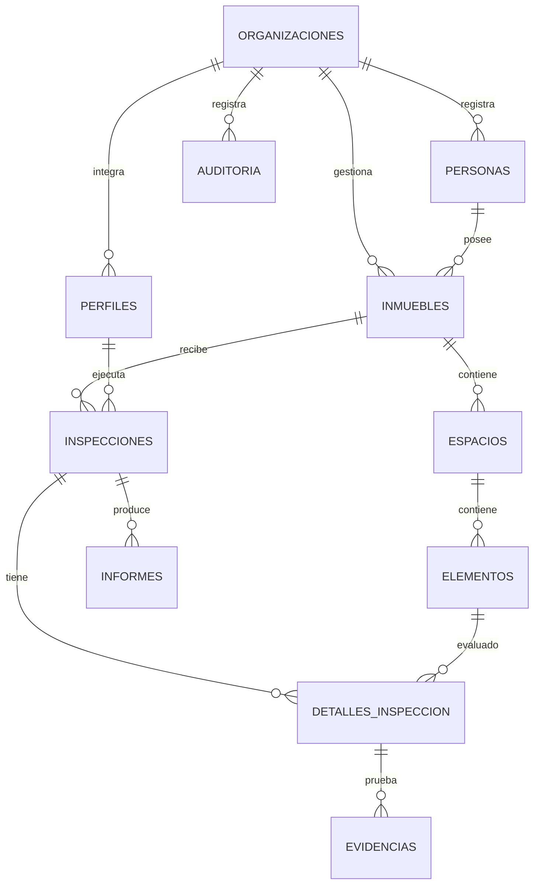

# Arquitectura

> Detalle ampliado: `documentos/InmoCheck_Diseno_Tecnico_REGENERADO.md` (§2 arquitectura, §10 carpetas, §11 flujos).

> **Estado (2026-11-20): en migración.** El back pasa del BFF de Next.js (`app/api/v1`) a un
> **backend propio en Spring Boot desplegado en AWS** (`backend/`). Este documento describe el
> destino. Mientras dura la migración, los módulos que aún no están en Spring siguen en el BFF
> (ver la sección 5 de `docs/tareas.md`). Por qué: `docs/decisiones.md`, "Backend propio en AWS".

## Visión general
InmoCheck tiene tres piezas:
- **Front**: aplicación Next.js en Vercel. Pantallas, formularios y un proxy delgado hacia el back.
- **Back**: API REST en **Spring Boot** en **AWS Elastic Beanstalk**. Sesión, rol, validación, reglas de negocio y PDF.
- **Supabase**: PostgreSQL con RLS y funciones SQL, Auth (usuarios y JWT) y Storage privado.



## Stack
| Capa | Tecnología |
|---|---|
| Front | Next.js 16.3 (App Router), React 19.2, TypeScript 5, Tailwind CSS 4, React Hook Form 7, Zod 4 (formularios) |
| Back | Spring Boot 3 con Java 21, Maven, Spring Web, Spring Security (OAuth2 Resource Server), Spring JDBC (`JdbcClient`), Bean Validation, OpenPDF |
| Datos | Supabase: PostgreSQL con RLS y funciones SQL, Auth (cookies httpOnly con `@supabase/ssr` en el front, JWT en el back) y Storage privado |
| Pruebas | JUnit 5 + MockMvc (back), Vitest (front), SQL de RLS (`supabase/tests/rls.sql`), Postman (contrato) |
| Despliegue | Vercel (front), AWS Elastic Beanstalk (back), Supabase en la nube (datos) |

---

## Front

### Responsabilidad
Mostrar pantallas, formularios y tablas; validar para dar una buena experiencia, y mostrar los estados de carga, vacío, error y guardado. **No decide la seguridad**: ocultar un botón solo cambia la interfaz. Además maneja la sesión (cookies) y reenvía la API al back.

### Carpetas
```text
app/
  (public)/login, recuperar-contrasena        pantallas sin sesión
  auth/confirmar, enlace, actualizar-contrasena   llegada desde los enlaces del correo
  (protected)/dashboard/…                       todas las pantallas con sesión
  api/v1/auth/login, logout, recuperar-contrasena, contrasena   sesión en cookies (se quedan en Next.js)
  api/v1/[...ruta]/route.ts                     proxy: reenvía el resto a Spring con el token
  layout.tsx, not-found.tsx, 403/               raíz, 404 y 403
components/
  ui/       Boton, Campo, CampoSeleccion, CampoContrasena, Tabla, Badge, Aviso,
            Tarjeta, PanelLateral, Paginacion, FiltrosUrl, ChipsFiltro, ListaDatos, Icono
  layout/   MenuLateral, NavegacionInferior, EncabezadoPagina, Pestanas, Marca,
            BotonCerrarSesion, PantallaError, TarjetaAcceso
features/   componentes de cada módulo
  auth/         FormularioLogin, FormularioRecuperar, FormularioNuevaContrasena, ProcesarEnlace…
  inmuebles/    FormularioInmueble, BotonEstadoInmueble
  inventario/   EditorInventario
  personas/     FormularioPropietario, FormularioInvitarInspector, DetalleInspector
  inspecciones/ FormularioInspeccion, TablaInspecciones, AccionesInspeccion, BarraProgreso
                realizar/ RealizarInspeccion, TarjetaElemento, SelectorEstado, FotosElemento…
  informes/     AccionesInforme, SelectorFotosInforme
lib/        api/client.ts (fetch tipado desde el navegador), api/servidor.ts (fetch a Spring
            desde Server Components), api/subir.ts, imagenes.ts (reduce fotos),
            navegacion.ts (menú por rol), url.ts (filtros en la URL), formato.ts…
schemas/    Zod de los formularios (mismos campos y mensajes que el back)
proxy.ts    refresca la sesión y bloquea /dashboard sin sesión
```
Cuando termine la migración se borran `server/services`, `server/repositories` y `server/pdf` del proyecto Next.js.

### Pantallas
| Ruta | Rol |
|---|---|
| `/login`, `/recuperar-contrasena` | Público |
| `/dashboard` (resumen con indicadores) | Admin |
| `/dashboard/inmuebles`, `/nuevo`, `/[id]` (datos, inventario, historial), `/[id]/editar` | Admin (el inspector solo consulta los suyos) |
| `/dashboard/inspecciones`, `/nueva`, `/[id]`, `/[id]/comparar`, `/[id]/informe` | Admin |
| `/dashboard/inspecciones/[id]/realizar` | Inspector asignado |
| `/dashboard/mis-inspecciones` | Inspector |
| `/dashboard/propietarios`, `/dashboard/inspectores` | Admin |
| `/dashboard/informes`, `/dashboard/configuracion` | Ambos |

### Patrones
- Las páginas son Server Components que leen los datos **de Spring** con `lib/api/servidor.ts`, que agrega el token de la sesión. `"use client"` solo para lo interactivo.
- Filtros, página y paneles laterales viven en la URL (`?search=`, `?page=`, `?nuevo=1`, `?ver=ID`).
- Formularios con React Hook Form y Zod. Las mutaciones van a `/api/v1` con `lib/api/client.ts`; el proxy las reenvía a Spring.
- Mobile first: menú lateral en escritorio y barra inferior en el celular. Las tablas pasan a lista por debajo de 760 px.
- Algo se marca "Guardado" solo cuando el servidor responde.

### Proxy `/api/v1/[...ruta]`
1. Lee la sesión de las cookies con `@supabase/ssr`. Si no hay sesión, responde `401` en `problem+json`.
2. Reenvía método, ruta, query y cuerpo (incluido `multipart/form-data` de las fotos) a `BACKEND_URL/api/v1/...`, con `Authorization: Bearer <access_token>`.
3. Devuelve tal cual el estado, las cabeceras útiles (`Content-Type`, `Location`) y el cuerpo de Spring.
4. No aplica reglas ni toca la base.

---

## Back (Spring Boot)

### Responsabilidad
Identificar al usuario a partir del JWT, cargar su perfil, verificar su rol, validar los datos, aplicar las reglas de negocio, hablar con Supabase y responder con JSON o con errores `problem+json`. Es el único que toca la base y el Storage.

### Carpetas (por módulo)
```text
backend/
  pom.xml
  src/main/java/com/inmocheck/
    InmocheckApplication.java
    config/        SeguridadConfig (JWT de Supabase), PropiedadesSupabase
    comun/
      sesion/      Actor, ActorResolver (perfil + organización desde perfiles), @RequiereRol
      datos/       EjecutorRls (abre la transacción con el rol y los claims del usuario)
      http/        ManejadorErrores (@RestControllerAdvice → ProblemDetail), Pagina<T>, ErrorDeCampo
      errores/     NoEncontradoException, ConflictoException, ProhibidoException…
    supabase/      ClienteStorage (subir, firmar 60 s, borrar), ClienteAuthAdmin (invitar, reenviar)
    auth/          MeController (GET /auth/me)
    inmuebles/     InmueblesController, InmueblesService, InmueblesRepository, dto/
    inventario/    EspaciosController, ElementosController, InventarioService, InventarioRepository, dto/
    propietarios/  …
    inspectores/   …
    inspecciones/  …  (crear, iniciar, detalles, finalizar, cancelar, reasignar)
    evidencias/    …
    comparacion/   ComparacionService (calcula al momento)
    informes/      InformesService, ActaPdf (OpenPDF)
    dashboard/     …
    auditoria/     …
  src/main/resources/application.yml   (todo lo sensible sale de variables de entorno)
  src/test/java/com/inmocheck/…
```

### Capas
| Capa | Clase | Hace | Nunca |
|---|---|---|---|
| Controller | `*Controller` | Recibe la petición, exige rol (`@RequiereRol`), valida el DTO (`@Valid`) y responde con el código del contrato | Acepta `organizacionId` o rol enviados por el cliente |
| Service | `*Service` | Aplica reglas y traduce errores (404, 409) | Arma SQL o conoce HTTP |
| Repository | `*Repository` | Hace consultas y llama funciones SQL con `JdbcClient` dentro de la transacción RLS | Decide reglas |
| Soporte | `comun/*`, `supabase/*`, `informes/ActaPdf` | Sesión, transacción RLS, errores, clientes de Storage y Auth Admin, PDF | — |

### Sesión y RLS en cada petición
1. Spring Security valida la firma, el vencimiento y el emisor del JWT de Supabase (JWKS del proyecto). Sin token o con un token inválido: `401`.
2. `ActorResolver` lee `perfiles` (rol, organización y `activo`). Si la cuenta está desactivada: `403 CUENTA_INACTIVA`.
3. `EjecutorRls` abre la transacción y ejecuta:
   ```sql
   set local role authenticated;
   select set_config('request.jwt.claims', :claimsDelToken, true);
   ```
   Desde ahí `auth.uid()`, `mi_organizacion()` y todas las políticas RLS funcionan igual que con el BFF.
4. El repositorio hace sus consultas o llama a la función SQL (`iniciar_inspeccion`, `finalizar_inspeccion`…), que valida estado y `version`.

Si una consulta se hiciera fuera de `EjecutorRls`, correría con el usuario de conexión y saltaría RLS. Por eso los repositorios solo reciben la conexión desde `EjecutorRls`, y hay una prueba que lo verifica.

### Módulos
`auth/me`, `inmuebles`, `inventario`, `propietarios`, `inspectores`, `inspecciones`, `evidencias`, `comparacion`, `informes`, `dashboard` y `auditoria`.

### API
Los mismos endpoints REST de `/api/v1`. El contrato completo está en `docs/contratos/api.md` y no cambia. Las cuatro rutas de sesión (`login`, `logout`, `recuperar-contrasena`, `contrasena`) siguen en Next.js.

### Acceso a Supabase desde el back
- **Base de datos:** JDBC por el pooler de sesión de Supabase (IPv4, puerto 5432). Siempre dentro de `EjecutorRls`.
- **Storage y Auth Admin:** API REST de Supabase con `SUPABASE_SERVICE_ROLE_KEY`. Solo los usan los servicios de inspectores (invitar y reenviar acceso), evidencias e informes, **después** de autorizar al usuario con una consulta bajo RLS.
- El front conserva `lib/supabase/server.ts` (leer la sesión y obtener el token) y `lib/supabase/client.ts` (solo `ProcesarEnlace`). `lib/supabase/admin.ts` se borra al terminar la migración.

---

## Base de datos (Supabase)

### Entidades

- Todas las tablas tienen `organizacion_id`.
- Los detalles guardan una copia del nombre del espacio y del elemento.
- Restricciones `UNIQUE`: `(organizacion_id, codigo)` en inmuebles, `(inspeccion_id, elemento_id)` en detalles y `(inspeccion_id, version)` en informes.
- Las llaves foráneas compuestas con `organizacion_id` impiden mezclar organizaciones.

### Funciones SQL (la lógica crítica vive aquí)
- **Flujo de inspección:** `crear_inspeccion`, `editar_inspeccion`, `iniciar_inspeccion`, `guardar_detalle`, `finalizar_inspeccion`, `cancelar_inspeccion`, `reasignar_inspeccion`. Validan estado, `version` y permisos dentro de una transacción.
- **Archivos:** `registrar_evidencia`, `eliminar_evidencia`, `registrar_informe`.
- **Plazo:** `limite_para_iniciar` (7:00 p. m. del día programado).
- **Ayudas de RLS:** `mi_organizacion`, `mi_rol`, `es_admin`, `soy_inspector_de`, `tengo_inspeccion_en_inmueble`.
- **Triggers:** `auditar_cambio` (auditoría automática) y `tocar_updated_at`.

La migración a Spring **no cambia la base**: Spring llama estas mismas funciones.

### Migraciones (`supabase/migrations/`)
`esquema_inicial` → `seguridad_rls` → `auditoria_automatica` → `flujo_inspecciones` → `evidencias_y_buckets` → `registrar_informe` → `plazo_para_iniciar`.

### Seguridad
- RLS en las 11 tablas: el administrador ve su organización y el inspector, solo sus asignaciones. Aplica igual con Spring gracias a `EjecutorRls`.
- Las fotos y los PDF van en buckets privados, con enlaces firmados de 60 s emitidos después de autorizar.
- La auditoría la escriben triggers y funciones; no se edita desde la app.
- Las pruebas de aislamiento entre organizaciones y roles están en `supabase/tests/rls.sql`.

Reglas y estados: `docs/reglas-de-negocio.md`.

---

## Despliegue
- **Front:** Vercel, https://inmocheck.vercel.app, con despliegue continuo desde `main`.
- **Back:** AWS Elastic Beanstalk, plataforma Java 21 (Corretto), una instancia en la capa gratuita, con el `.jar` que genera `mvn package`. Expuesto **solo por HTTPS**, porque viaja el token del usuario.
- **Datos, auth y archivos:** proyecto de Supabase en la nube. Las migraciones se aplican con `npx supabase db push` y luego `seed.sql`.

### Variables de entorno
| Dónde | Variable | Para qué |
|---|---|---|
| Vercel | `NEXT_PUBLIC_SUPABASE_URL`, `NEXT_PUBLIC_SUPABASE_ANON_KEY` | Sesión en cookies |
| Vercel | `BACKEND_URL` (solo servidor) | URL HTTPS de Spring a la que reenvía el proxy |
| AWS | `SUPABASE_URL` | API REST de Storage y Auth, y emisor y JWKS del JWT |
| AWS | `SUPABASE_DB_URL`, `SUPABASE_DB_USER`, `SUPABASE_DB_PASSWORD` | Conexión JDBC por el pooler de sesión |
| AWS | `SUPABASE_SERVICE_ROLE_KEY` | Storage e invitaciones. **Nunca** en el front ni en el código |

Durante la migración, Vercel conserva `SUPABASE_SERVICE_ROLE_KEY` para los módulos que aún están en el BFF. Se retira al terminar.
