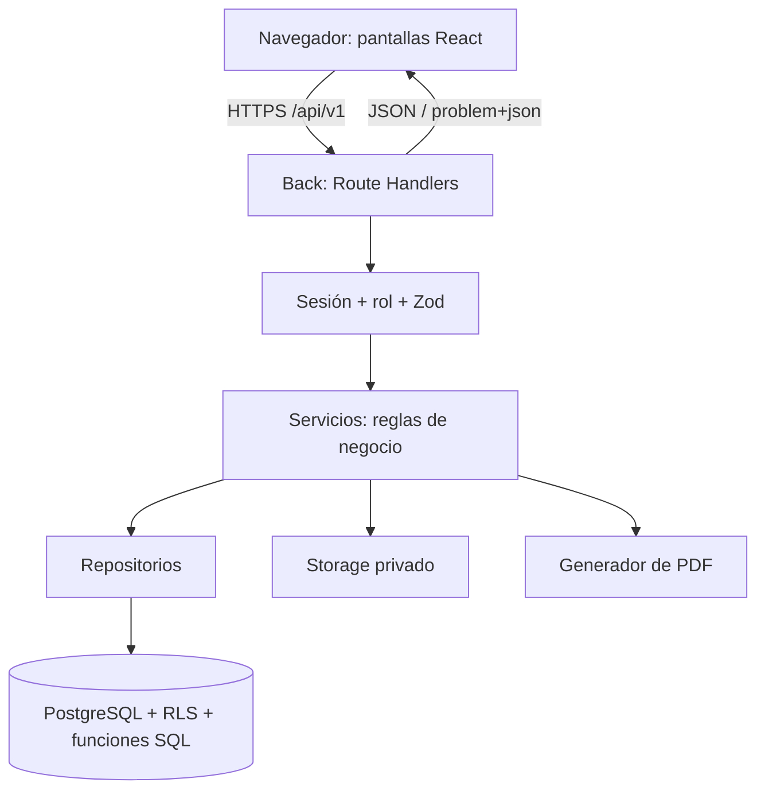
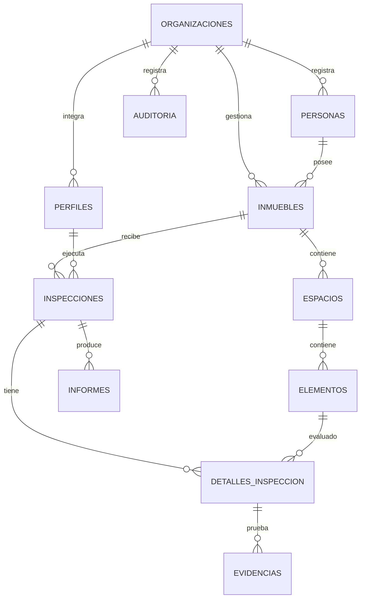

# Arquitectura

> Detalle ampliado: `documentos/InmoCheck_Diseno_Tecnico_REGENERADO.md` (§2 arquitectura, §10 carpetas, §11 flujos).

## Visión general
InmoCheck es **una sola aplicación Next.js** que tiene dos partes: el **front** (pantallas) y el **back** (API BFF en `app/api/v1`). Detrás está **Supabase** como base de datos, autenticación y almacenamiento.



¿Por qué no Spring Boot + MySQL como en el stack del diplomado? Se usó un BFF en Next.js con Supabase para tener un solo proyecto y un solo despliegue, y Auth, RLS y archivos privados listos (ver `docs/decisiones.md`).

## Stack
| Capa | Tecnología |
|---|---|
| Front | Next.js 16.3 (App Router), React 19.2, TypeScript 5, Tailwind CSS 4, React Hook Form 7 |
| Back | Next.js Route Handlers (`app/api/v1`), Zod 4, `@react-pdf/renderer` |
| Datos | Supabase: PostgreSQL con RLS, Auth (cookies httpOnly con `@supabase/ssr`) y Storage privado |
| Pruebas | Vitest, SQL de RLS (`supabase/tests/rls.sql`), Postman |
| Despliegue | Vercel (app) y Supabase en la nube (datos) |

---

## Front

### Responsabilidad
Mostrar pantallas, formularios y tablas; validar para dar una buena experiencia, y mostrar los estados de carga, vacío, error y guardado. **No decide la seguridad**: ocultar un botón solo cambia la interfaz.

### Carpetas
```text
app/
  (public)/login, recuperar-contrasena        pantallas sin sesión
  auth/confirmar, enlace, actualizar-contrasena   llegada desde los enlaces del correo
  (protected)/dashboard/…                       todas las pantallas con sesión
  layout.tsx, not-found.tsx, 403/               raíz, 404 y 403
components/
  ui/       Boton, Campo, CampoSeleccion, CampoContrasena, Tabla, Badge, Aviso,
            Tarjeta, PanelLateral, Paginacion, FiltrosUrl, ChipsFiltro, ListaDatos, Icono
  layout/   MenuLateral, NavegacionInferior, EncabezadoPagina, Pestanas, Marca,
            BotonCerrarSesion, PantallaError, TarjetaAcceso
features/   componentes de cada módulo
  auth/         FormularioLogin, FormularioRecuperar, FormularioNuevaContrasena, ProcesarEnlace…
  inmuebles/    FormularioInmueble, BotonEstadoInmueble
  inventario/   EditorInventario
  personas/     FormularioPropietario, FormularioInvitarInspector, DetalleInspector
  inspecciones/ FormularioInspeccion, TablaInspecciones, AccionesInspeccion, BarraProgreso
                realizar/ RealizarInspeccion, TarjetaElemento, SelectorEstado, FotosElemento…
  informes/     AccionesInforme, SelectorFotosInforme
lib/        api/client.ts (fetch tipado), api/subir.ts, imagenes.ts (reduce fotos),
            navegacion.ts (menú por rol), url.ts (filtros en la URL), formato.ts…
schemas/    Zod compartido con el back
proxy.ts    refresca la sesión y bloquea /dashboard sin sesión
```

### Pantallas
| Ruta | Rol |
|---|---|
| `/login`, `/recuperar-contrasena` | Público |
| `/dashboard` (resumen con indicadores) | Admin |
| `/dashboard/inmuebles`, `/nuevo`, `/[id]` (datos, inventario, historial), `/[id]/editar` | Admin (el inspector solo consulta los suyos) |
| `/dashboard/inspecciones`, `/nueva`, `/[id]`, `/[id]/comparar`, `/[id]/informe` | Admin |
| `/dashboard/inspecciones/[id]/realizar` | Inspector asignado |
| `/dashboard/mis-inspecciones` | Inspector |
| `/dashboard/propietarios`, `/dashboard/inspectores` | Admin |
| `/dashboard/informes`, `/dashboard/configuracion` | Ambos |

### Patrones
- Las páginas son Server Components que leen los datos del servicio. `"use client"` solo para lo interactivo.
- Filtros, página y paneles laterales viven en la URL (`?search=`, `?page=`, `?nuevo=1`, `?ver=ID`).
- Formularios con React Hook Form y el mismo esquema Zod de la API. Las mutaciones van a `/api/v1` con `lib/api/client.ts`.
- Mobile first: menú lateral en escritorio y barra inferior en el celular. Las tablas pasan a lista por debajo de 760 px.
- Algo se marca "Guardado" solo cuando el servidor responde.

---

## Back

### Responsabilidad
Identificar al usuario, verificar su rol, validar los datos, aplicar las reglas de negocio, hablar con Supabase y responder con JSON o con errores `problem+json`.

### Capas
| Capa | Carpeta | Hace | Nunca |
|---|---|---|---|
| Route Handler | `app/api/v1/**/route.ts` | Recibe la petición, exige sesión y rol, valida con Zod y responde | Acepta `organizacionId` o rol enviados por el cliente |
| Servicio | `server/services/*.service.ts` | Aplica reglas y traduce errores (404, 409) | Mezcla React con SQL |
| Repositorio | `server/repositories/*.repository.ts` | Hace consultas y RPC a Supabase | Decide reglas o usa `service_role` en el navegador |
| Soporte | `server/auth/sesion.ts`, `server/http/*`, `server/pdf/acta.tsx` | Sesión (`requireRole`, `exigirRol`), errores, respuestas y PDF del acta | — |

### Módulos (servicio + repositorio)
`inmuebles`, `inventario`, `propietarios`, `inspectores`, `inspecciones`, `evidencias`, `comparacion`, `informes` y `dashboard`.

### API
43 endpoints REST en `/api/v1`. El contrato completo está en `docs/contratos/api.md`.

### Clientes de Supabase
- `lib/supabase/server.ts`: cliente con la sesión del usuario (cookies). RLS aplica siempre.
- `lib/supabase/admin.ts`: cliente `service_role`, **solo servidor**. Lo usan los servicios de inspectores (invitar y reenviar acceso), evidencias e informes (archivos en Storage, siempre después de autorizar al usuario).
- `lib/supabase/client.ts`: cliente del navegador. Solo lo usa `ProcesarEnlace` para leer la sesión que llega en los enlaces del correo.

---

## Base de datos (Supabase)

### Entidades

- Todas las tablas tienen `organizacion_id`.
- Los detalles guardan una copia del nombre del espacio y del elemento.
- Restricciones `UNIQUE`: `(organizacion_id, codigo)` en inmuebles, `(inspeccion_id, elemento_id)` en detalles y `(inspeccion_id, version)` en informes.
- Las llaves foráneas compuestas con `organizacion_id` impiden mezclar organizaciones.

### Funciones SQL (la lógica crítica vive aquí)
- **Flujo de inspección:** `crear_inspeccion`, `editar_inspeccion`, `iniciar_inspeccion`, `guardar_detalle`, `finalizar_inspeccion`, `cancelar_inspeccion`, `reasignar_inspeccion`. Validan estado, `version` y permisos dentro de una transacción.
- **Archivos:** `registrar_evidencia`, `eliminar_evidencia`, `registrar_informe`.
- **Plazo:** `limite_para_iniciar` (7:00 p. m. del día programado).
- **Ayudas de RLS:** `mi_organizacion`, `mi_rol`, `es_admin`, `soy_inspector_de`, `tengo_inspeccion_en_inmueble`.
- **Triggers:** `auditar_cambio` (auditoría automática) y `tocar_updated_at`.

### Migraciones (`supabase/migrations/`)
`esquema_inicial` → `seguridad_rls` → `auditoria_automatica` → `flujo_inspecciones` → `evidencias_y_buckets` → `registrar_informe` → `plazo_para_iniciar`.

### Seguridad
- RLS en las 11 tablas: el administrador ve su organización y el inspector, solo sus asignaciones.
- Las fotos y los PDF van en buckets privados, con enlaces firmados de 60 s emitidos después de autorizar.
- La auditoría la escriben triggers y funciones; no se edita desde la app.
- Las pruebas de aislamiento entre organizaciones y roles están en `supabase/tests/rls.sql`.

Reglas y estados: `docs/reglas-de-negocio.md`.

---

## Despliegue
- App (front y back juntos): Vercel, https://inmocheck.vercel.app, con despliegue continuo desde `main`.
- Datos, auth y archivos: proyecto de Supabase en la nube. Las migraciones se aplican con `npx supabase db push` y luego `seed.sql`.
- Variables: `NEXT_PUBLIC_SUPABASE_URL`, `NEXT_PUBLIC_SUPABASE_ANON_KEY` y `SUPABASE_SERVICE_ROLE_KEY`. Esta última es solo de servidor y nunca lleva `NEXT_PUBLIC_`.
